# Как сделать вещь для пингвинов

Памятка для тех, кто придумывает одежду, предметы и окружение для пингвинов Учебника101.

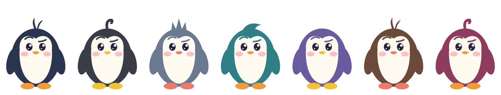

Здесь всё, что нужно: модель пингвина, шаблоны, все готовые вещи как образцы и примерочная, где свой рисунок сразу видно на пингвине.

**Примерочная онлайн:** https://icookiess.github.io/penguin-kit/preview.html

## Содержание

1. [Что можно придумать](#что-можно-придумать)
2. [С чего начать](#с-чего-начать)
3. [Что лежит в папке](#что-лежит-в-папке)
4. [Пингвин: размеры и точки](#пингвин-размеры-и-точки)
5. [Вещи на пингвине](#вещи-на-пингвине)
6. [Вещь рядом](#вещь-рядом)
7. [Появление](#появление)
8. [Линейки: фон и платформа](#линейки-фон-и-платформа)
9. [Цвета и перекраска](#цвета-и-перекраска)
10. [Что можно и что нельзя рисовать](#что-можно-и-что-нельзя-рисовать)
11. [Как устроен файл](#как-устроен-файл)
12. [В чём рисовать](#в-чём-рисовать)
13. [Что отправить](#что-отправить)
14. [Проверь перед отправкой](#проверь-перед-отправкой)

## Что можно придумать

| Что | Где на пингвине | Шаблон |
|---|---|---|
| Головной убор: шапка, кепка, наушники, венок | голова | `templates/head.svg` |
| Очки и маски | лицо | `templates/face.svg` |
| Шарф, бабочка, бусы, медаль | шея | `templates/neck.svg` |
| Одежда: свитер, жилет, халат | животик | `templates/body.svg` |
| Обувь | лапы | `templates/feet.svg` |
| Предмет в крыле: книга, кружка, кисточка | правое крыло | `templates/hand.svg` |
| То, что за спиной: рюкзак, плащ | спина | `templates/back.svg` |
| Вещь рядом: гитара, мольберт, снеговик | стоит рядом на платформе | `templates/side.svg` |
| Появление: как пингвин приходит и уходит | значок в гардеробе | `templates/effect.svg` |
| Фон линейки | позади пингвина | `templates/background.svg` |
| Платформа линейки | под пингвином | `templates/platform.svg` |

В каждом месте пингвин носит одну вещь. Одна вещь занимает одно место: шапка с очками — это две вещи.

## С чего начать

1. Скачайте папку: зелёная кнопка **Code → Download ZIP** и распакуйте.
2. Посмотрите готовые вещи в папке `examples/` — это образцы. Откройте любой файл в браузере или редакторе.
3. Возьмите шаблон нужного места из `templates/` (или копию похожей вещи из `examples/`) и нарисуйте свою вещь.
4. Перетащите файл в [примерочную](https://icookiess.github.io/penguin-kit/preview.html) (или откройте `preview.html` из папки) и посмотрите на пингвине всех цветов. Внизу списка — проверка: что поправить.
5. Отправьте файл и короткое описание (см. [Что отправить](#что-отправить)).

## Что лежит в папке

```
penguin/        модель пингвина: penguin.svg и colors.svg (все 7 цветов)
templates/      пустые шаблоны — начинайте с них
examples/       все готовые вещи, фоны и платформы — образцы
  head/ face/ neck/ body/ feet/ hand/ back/   вещи на пингвине
  side/         вещи рядом
  effect/       значки появления
  lines/        фоны и платформы линеек
gallery/        картинки для этой памятки
preview.html    примерочная
```

## Пингвин: размеры и точки

Пингвин нарисован в рамке **120 × 160**. Ось **x** идёт вправо, ось **y** — вниз: чем больше y, тем ниже точка.

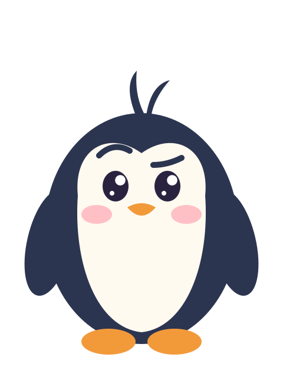

| Что | Где |
|---|---|
| Тело | овал с центром (60, 97), ширина 82, высота 98: верх — y 48, низ — y 146 |
| Светлый животик и лицо | от x 33 до x 87, начинается с y 55 |
| Глаза | (49, 79) и (71, 79) |
| Клюв | (60, 89) |
| Хохолок | торчит над головой до y 30 |
| Шея (где шарф) | y 96…106 |
| Крылья | левое — около x 21, правое — около x 99; кончик правого — (104, 124) |
| Где крылья крепятся | плечи (26, 83) и (94, 83) — вокруг них крылья качаются |
| Лапы | левая (46, 145), правая (74, 145) |
| Пол | y 151 — на этой линии стоят лапы |

На сайте пингвин ростом около 100 пикселей: одна единица рамки — меньше пикселя. Линии тоньше 1,5 и детали меньше 3 единиц почти не видно. Рисуйте крупно и просто.

Пингвин живой: дышит, моргает и следит глазами за курсором. Его можно взять и перенести — тогда он висит, лапы смотрят вниз, а крылья разведены в стороны. Поэтому вещи на крыльях и лапах рисуются в своих группах: они качаются вместе с крылом или лапой.

**Что поверх чего** (от дальнего к ближнему): за спиной → тело → одежда → шея → очки → голова → левое крыло → правое крыло с предметом → лапы с обувью.

## Вещи на пингвине

Все вещи на пингвине рисуются в одном шаблоне 120 × 160. В шаблоне есть полупрозрачный пингвин (группа `guide`) — по нему удобно примерять. На сайт он не попадает.

### Голова

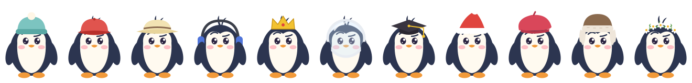

Группа `body`. Голова начинается на y 48, хохолок торчит выше. Шапка закрывает хохолок. Не закрывайте глаза (y 79): нижний край шапки — не ниже y 66.

### Очки

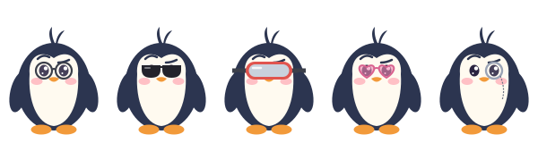

Группа `body`. Центры глаз — (49, 79) и (71, 79). Стёкла можно сделать полупрозрачными (`fill-opacity`), тогда глаза видны.

### Шея

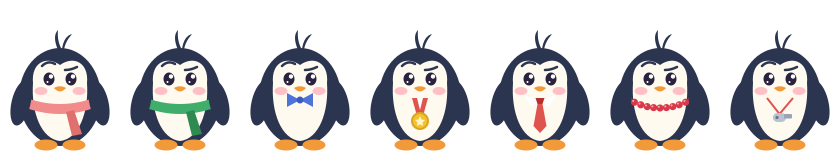

Группа `body`. Шарф лежит на линии y 96…106, бусы и медали свисают ниже, на животик.

### Одежда

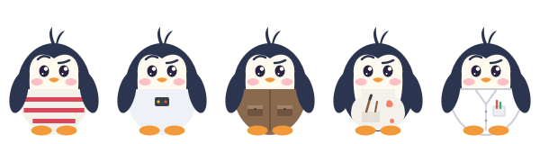

Группа `body`. Одежда закрывает животик ниже шеи: от y 99 до низа тела y 146 и не выходит за края тела. Крылья лягут поверх одежды. Проще всего начать с копии `examples/body/body-sweater.svg` — там форма уже по телу.

### Лапы

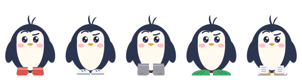

Левую лапу — в группе `footL`, правую — в `footR`: лапы качаются отдельно. Подошва — на полу (y 151), не ниже. Можно нарисовать одну лапу и отразить её для другой: `transform="translate(120 0) scale(-1 1)"` (так сделаны ласты).

### В крыле

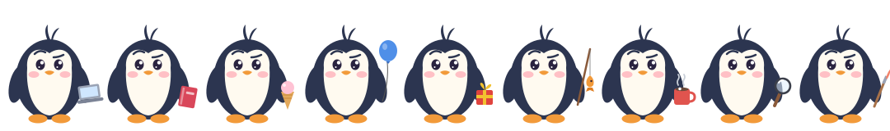

Группа `wingR` — правое крыло (справа на картинке). Предмет держится у кончика крыла (104, 124). Он может выходить за правый край рамки на несколько единиц, как удочка или шарик, но не сильно.

### За спиной

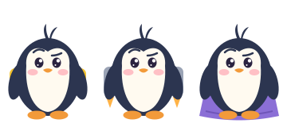

Группа `back` — она позади пингвина. Видно только то, что выглядывает из-за тела: края рюкзака, полы плаща.

## Вещь рядом

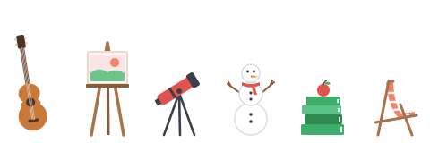

Шаблон `templates/side.svg`, рамка **60 × 160**, пол — **y 151** (пунктир). Вещь стоит на полу и рисуется целиком в рамке.

На сайте вещь стоит слева от пингвина на его платформе и уменьшена до 80 %. Когда пингвина переносят, платформа с вещью прилетает за ним на маленьких моторчиках — поэтому вещь должна твёрдо стоять на полу.

Вещь рядом примерно с пингвина ростом или ниже: верх — примерно не выше y 40.

## Появление

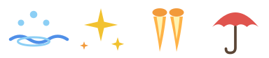

Появление — то, как пингвин приходит на страницу и уходит: выныривает из воды, вспыхивает искрами, прилетает на ракете, спускается на зонтике.

Само движение — это программа, его не рисуют. Для нового появления нужно:

- значок для гардероба — шаблон `templates/effect.svg`, рамка **52 × 56**;
- описание словами: что происходит, когда пингвин приходит и когда уходит. Например: «приходит — падает лист и превращается в пингвина; уходит — пингвин сворачивается в лист и улетает вверх».

## Линейки: фон и платформа

Линейка — набор из 5–6 вещей одной темы. Одна из них — вещь рядом. У кого есть все вещи линейки и кто поставил рядом её вещь, получает фон и свою платформу.

| Зима | Космос | Учёный |
|---|---|---|
| 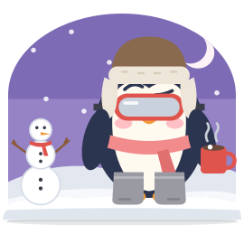 | 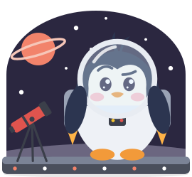 | 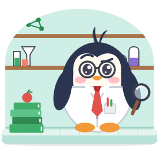 |
| **Художник** | **Море** | **Музыка** |
| 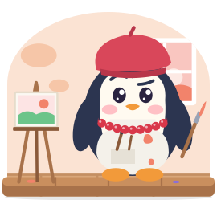 | 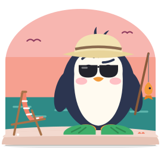 | 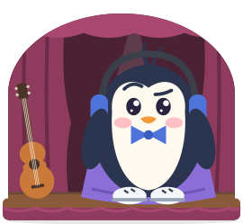 |

Готовые линейки:

- Зима: ушанка, горнолыжная маска, шарф, валенки, кружка какао, снеговик.
- Космос: шлем, скафандр, реактивный ранец, ракета, телескоп.
- Учёный: круглые очки, галстук, халат, лупа, стопка книг.
- Художник: берет, фартук, кисточка, бусы, мольберт.
- Море: панама, тёмные очки, ласты, удочка, шезлонг.
- Музыка: наушники, бабочка, кеды, плащ, гитара.

Своя линейка — это вещи (можно брать и уже готовые), обязательно одна вещь рядом, фон и платформа.

**Фон** — шаблон `templates/background.svg`. Рамка: x от −44 до 124, y от 10 до 163, пол — y 163. На сайте фон обрезается аркой (красный пунктир) — за аркой ничего не видно. В шаблоне полупрозрачно показано, где стоят пингвин, платформа и вещь рядом. Самое интересное рисуйте по краям и вверху: середину закрывает пингвин. Низ фона — земля или пол.

**Платформа** — шаблон `templates/platform.svg`. Это плоская подставка вместо льдины. Верх — y 0 (на нём стоят лапы), низ — y 12, по ширине — от x −48 до 128. Платформа должна быть ровной сверху: на ней стоят пингвин и вещь рядом.

Образцы — в `examples/lines/`.

## Цвета и перекраска

У пингвина один цвет оперения из семи (рисунок вверху), клюв и лапы — оранжевые, жёлтые или коралловые. Вещь должна хорошо смотреться на всех семи — проверяйте в примерочной.

Цвета пишутся так: `#e0544e`. Цвета готовых вещей — хороший образец: мягкие, не кислотные.

**Перекраска.** Обычную вещь пингвин может перекрасить в любую из 12 красок:


Чтобы вещь перекрашивалась красиво:

- у неё один главный цвет и, если нужно, его оттенки (темнее или светлее) — они поменяются вместе с главным;
- все остальные детали — белые, серые, графитовые или коричневые: они при перекраске не меняются.

Пример: кепка — красная (`#e0544e`) с тёмно-красным козырьком (`#b8302b`). В зелёной краске она станет зелёной с тёмно-зелёным козырьком.

В описании напишите, какой цвет главный и какие — его оттенки.

**Редкие вещи** не перекрашиваются, и у них может быть несколько ярких цветов. Это праздничные вещи (Новый год, 23 февраля, 8 Марта, 1 сентября, Масленица) и награды за достижения (как шапка выпускника и медаль).

## Что можно и что нельзя рисовать

Можно — всё доброе, мирное и школьное: одежда, хобби, наука, спорт, музыка, природа, профессии, времена года, наши праздники.

Нельзя:

- **синий и жёлтый в одной вещи**, фоне или платформе — даже голубой с золотым. Если перекрашиваемая вещь, помните: краска может стать синей или жёлтой, поэтому детали — только белые, серые, графитовые или коричневые;
- **радугу и разноцветные полоски** — у вещи одна цветовая гамма;
- **надписи, буквы и цифры** — ни на одежде, ни на фоне;
- **флаги, гербы, эмблемы, логотипы и марки**;
- **известных персонажей** из мультфильмов, игр и фильмов, похожих на них героев;
- **страшное, грустное и опасное** — только мирные предметы;
- **чужие картинки** — рисуйте сами.

**Стиль** — «пастель без объёма»:

- плоские заливки без градиентов, теней и бликов-размытий (маленький светлый блик-кружок можно);
- мягкие цвета;
- обводка тонкая или её нет;
- крупные простые формы.

## Как устроен файл

Каждая вещь — это **SVG**: картинка, записанная как код из фигур. Вот кепка целиком:

```xml
<svg xmlns="http://www.w3.org/2000/svg" viewBox="0 0 120 160">
  <g id="body">
    <path d="M34 62 Q34 36 60 36 Q86 36 86 62Z" fill="#e0544e"/>
    <path d="M28 62 Q60 73 92 62 Q60 56 28 62Z" fill="#b8302b"/>
    <circle cx="60" cy="37" r="2.5" fill="#b8302b"/>
  </g>
</svg>
```

**Рамка.** `viewBox` — как в шаблоне, не меняйте его и не двигайте пингвина-образец.

**Группы.** Каждая часть рисунка — в своей группе:

| Группа | Что |
|---|---|
| `back` | за спиной |
| `body` | туловище и голова: шапки, очки, шея, одежда |
| `wingL`, `wingR` | левое и правое крыло |
| `footL`, `footR` | левая и правая лапа |
| `guide` | пингвин-образец, на сайт не попадает |

Что нарисовано вне групп, попадёт в `body`. У вещи рядом, значка и фона — всё в `body`.

**Можно использовать только** фигуры `path`, `circle`, `ellipse`, `rect`, `polygon`, `polyline`, `line` и группы `g`. У них — атрибуты `fill`, `stroke`, `stroke-width`, `opacity`, `fill-opacity`, `stroke-opacity`, `transform`, `stroke-linecap`, `stroke-linejoin`, `stroke-dasharray`, `fill-rule` и координаты.

**Не попадёт на сайт:** текст (`text`), картинки внутри SVG (`image`), градиенты, фильтры, тени, маски и обрезка (`clipPath`, `mask`), стили (`style`, `class`). Если цвет задан в `style="fill:..."`, на сайте вещь окажется чёрной. Примерочная покажет всё, что выпадет.

**Полупрозрачность** — через `opacity` или `fill-opacity`, например стекло шлема.

**Размер файла** — до 200 КБ. Обычно вещь — 1–3 КБ.

## В чём рисовать

**Прямо в коде.** Откройте копию похожей вещи из `examples/` в любом текстовом редакторе (VS Code, Блокнот), меняйте числа и цвета, сохраняйте и смотрите в примерочной. Так сделаны все готовые вещи. Справочник по фигурам: [developer.mozilla.org — SVG](https://developer.mozilla.org/ru/docs/Web/SVG/Tutorial).

**Inkscape** (бесплатный редактор, inkscape.org). Откройте шаблон, на панели «Слои и объекты» видны группы `body`, `wingR` и другие — рисуйте внутри нужной (двойной щелчок по группе — войти в неё). Inkscape пишет цвета в `style`, поэтому сохраняйте так: **Файл → Сохранить копию → Оптимизированный SVG**, и в настройках:

- включите преобразование CSS в XML-атрибуты;
- выключите сворачивание групп;
- выключите удаление неиспользуемых ID.

Проверьте файл в примерочной: если что-то выпало, она скажет.

**Figma и другие редакторы** тоже подходят: назовите группы как в шаблоне, при экспорте в SVG включите сохранение имён слоёв как `id` и проверьте результат в примерочной.

**Эскиз на бумаге.** Если идея есть, а нарисовать пока трудно — пришлите фото эскиза на клетчатой бумаге с подписями цветов и размеров.

## Что отправить

1. **Файл SVG.** Имя — латиницей: место и короткое название через дефис, например `head-bucket.svg`, `hand-kite.svg`, `side-globe.svg`, `bg-forest.svg`.
2. **Описание** в сообщении:
   - название по-русски, как в гардеробе: «Панама», «Кружка какао» (до 40 знаков);
   - место: голова, очки, шея, одежда, лапы, в крыле, за спиной, рядом, появление, фон, платформа;
   - перекрашивается ли и какой цвет главный;
   - если редкая — к какому празднику или за что;
   - если линейка — её название и список всех вещей;
   - если появление — что происходит, словами.

Цену назначать не нужно.

## Проверь перед отправкой

- [ ] Рисунок сделан в шаблоне, рамка не менялась.
- [ ] Части в правильных группах: обувь в `footL`/`footR`, предмет в крыле — в `wingR`.
- [ ] В примерочной всё зелёное, ничего не выпало.
- [ ] Вещь хорошо видна на пингвине всех семи цветов и в маленьком размере.
- [ ] Нет синего вместе с жёлтым, радуги, надписей, эмблем, известных персонажей.
- [ ] Если вещь перекрашивается — детали белые, серые, графитовые или коричневые.
- [ ] Глаза не закрыты (если это не очки).
- [ ] Есть описание.
